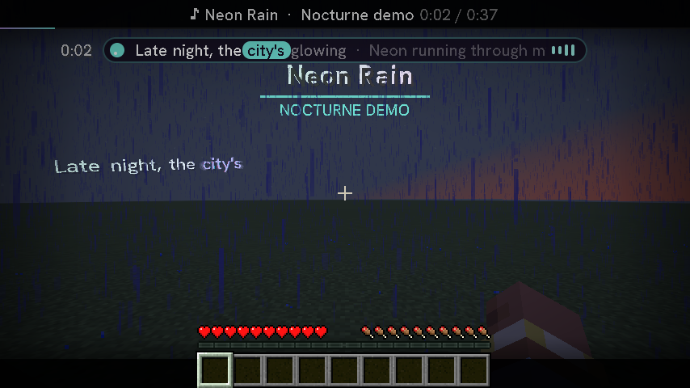
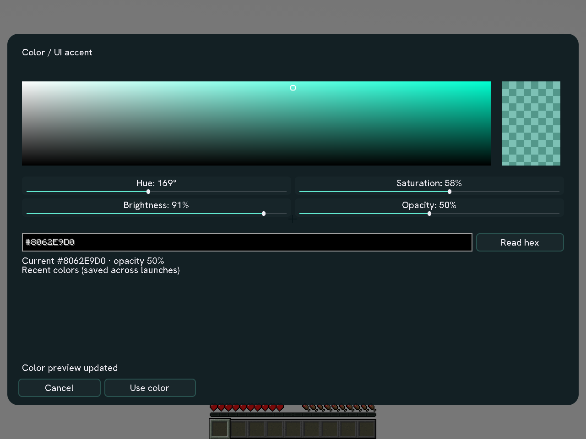

**Your music belongs in Minecraft.**

Synchronized world lyrics, desktop playback and a Studio that makes it yours.

[**Explore the website**](https://truwty.github.io/nocturne/) · [**Choose a download**](https://truwty.github.io/nocturne/downloads.html) · [User guide](docs/GUIDE.md) · [Support](SUPPORT.md)

## The soundtrack stays with you

Nocturne is a **client-side Fabric mod**. It detects your desktop music automatically, renders lyrics in your world and keeps playback controls a keypress away. Desktop detection needs **no Spotify login**. An optional account connection enables supported extras.

| Make the lyrics yours | Keep the music going |
| --- | --- |
|  |  |
| Word-level karaoke when source timings exist, translations, romanization and a timeline editor. | Player priorities, configurable playback shortcuts and capability-aware controls. |

| Set the atmosphere | Make it comfortable |
| --- | --- |
|  |  |
| Live themes, a full color picker, saved presets and draggable HUD layouts. | Context profiles, readable backplates and independent motion controls, including a photosensitivity-friendly preset. |

## Start listening

1. [Choose your exact Minecraft version and Nocturne release](https://truwty.github.io/nocturne/downloads.html).
2. Install the listed Java version, Fabric Loader and matching Fabric API. Put **one** Nocturne mod JAR in the instance's `mods` folder.
3. Start your desktop music player and press **N** in Minecraft. Try the built-in demo to check rendering.

**Published compatibility is listed in [SUPPORT.md](SUPPORT.md) and the download selector.** Unlisted versions are not supported. Ports from Minecraft 1.8.9 onward are separate engineering work; changing a version label does not make a JAR compatible. No server installation is needed. Follow your server's mod rules; Hypixel approval is not claimed.

## Built to stay out of the way

Adaptive effect budgets, bounded caches and cancelled stale downloads keep background work controlled. Screen hiding, off-screen captions and quiet context profiles help keep gameplay readable. Source availability still determines lyric coverage and timing quality.

[Feature and setup guide](docs/GUIDE.md) · [Exact validation and limits](VALIDATION.md) · [Changelog](CHANGELOG.md)

## Contribute or report a problem

- [Build and version support](SUPPORT.md) — pinned tools, reproducible release commands and compatibility requirements.
- [Report a bug](https://github.com/Truwty/nocturne/issues) — include Minecraft/loader versions and a filtered diagnostic export from **N → Health → Releases & diagnostics**. Review it before sharing.
- [Source and licensing](LICENSE) · [Third-party notices](THIRD_PARTY_NOTICES.md).

The website uses real Nocturne screenshots. External shader/resource packs shown in captures are not bundled. Nocturne is an independent Minecraft mod and is not affiliated with Mojang or Microsoft.
