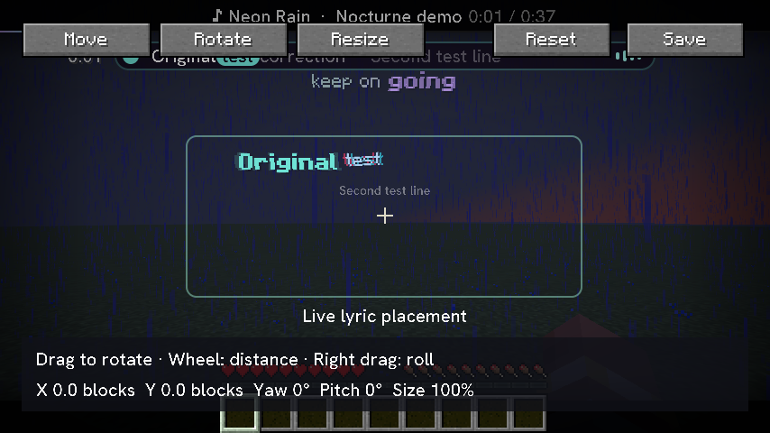
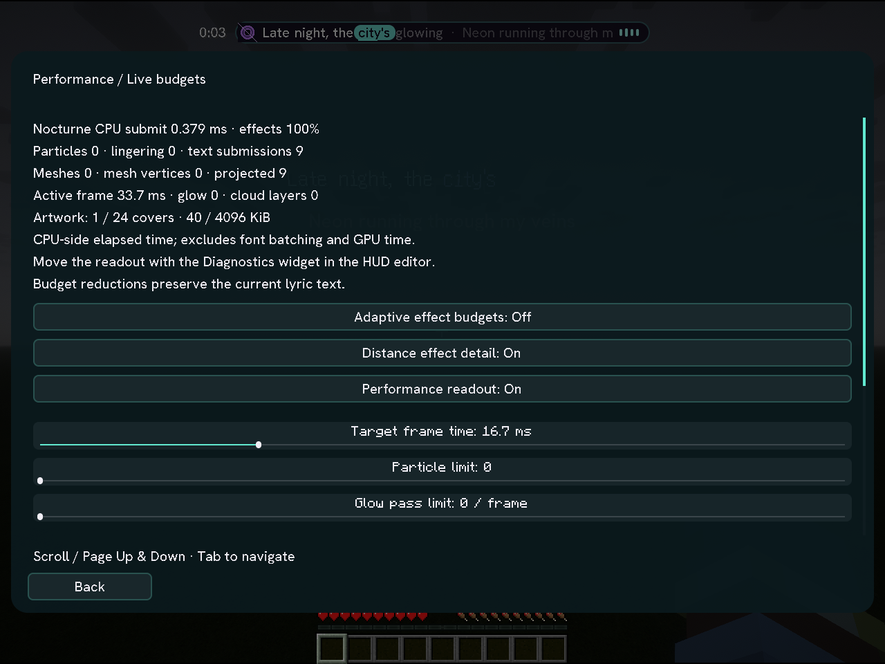

**World lyrics. Desktop playback. Your own atmosphere.**

[**Download Nocturne →**](https://truwty.github.io/nocturne/downloads.html) &nbsp; · &nbsp; [Explore the website](https://truwty.github.io/nocturne/) &nbsp; · &nbsp; [Read the guide](docs/GUIDE.md)

CLIENT ONLY &nbsp; / &nbsp; FABRIC &nbsp; / &nbsp; AUTOMATIC DESKTOP DETECTION

 

01 / THE WORLD SESSION — actual Nocturne capture, playing the built-in demo.

## The music comes with you.

Nocturne brings your desktop soundtrack into Minecraft: lyrics in the world, a compact playback HUD, and a Studio for getting every detail right. It detects supported desktop players automatically. **No Spotify login is needed for desktop detection**; an optional account connection enables supported extras.

**Official Release Version 1 · Windows · Minecraft 26.1.2 · Fabric.** New in 1.0: isolated music audio, real spectrum and tempo analysis, a lyrics-free visualizer, library browsing, first-run checks, controller text entry, persistent artwork, download management and guided editors. [Read the release notes](docs/releases/1.0.0.md).

[Get started](#three-steps-to-your-first-session) · [Inside the Studio](#inside-the-studio) · [Compatibility](#choose-the-build-for-your-world) · [Development & support](#behind-the-session)

## Inside the Studio

<table>
<tr>
<td width="50%"><strong>02 / Follow every word</strong></td>
<td width="50%"><strong>03 / Find your color</strong></td>
</tr>
<tr>
<td></td>
<td></td>
</tr>
<tr>
<td>Line and word timing, lyric history, translation and romanization where available. Correct timing in the interactive editor. True word-level karaoke uses source-provided word timestamps.</td>
<td>Preview before applying. Tune colors and opacity, browse presets, and undo changes. Save appearances for individual songs.</td>
</tr>
<tr>
<td><strong>04 / Keep the controls close</strong></td>
<td><strong>05 / Put it in its place</strong></td>
</tr>
<tr>
<td></td>
<td></td>
</tr>
<tr>
<td>Gameplay shortcuts, player priorities and album artwork. Queue, volume, shuffle and repeat controls appear where the selected integration supports them.</td>
<td>Snap the HUD into place, keep separate menu and gameplay layouts, and choose profiles for exploration, combat or a quiet screenshot.</td>
</tr>
</table>

### Atmosphere with a little restraint.

Readable backplates, outlines and independent motion controls help lyrics fit the moment. Start with the **photosensitivity-friendly preset** when you want fewer flashes and animated effects. Automatic screen hiding and off-screen fallback keep captions useful during gameplay.

Adaptive effect budgets, separate particle and glow limits, bounded artwork caching and cancelled obsolete requests keep work controlled. The built-in readout shows CPU-side rendering time and submission counts; it is not a GPU or FPS benchmark.

<strong>Open the extended capture gallery</strong> — color tools, performance and rendering

 

**A closer look at the palette**

**See the rendering workload**

**A shader and resource-pack session**

These are actual mod captures. External shader and resource packs are not bundled. A capture does not establish compatibility with every pack; see [validation and limits](VALIDATION.md).

## Three steps to your first session

1. **Choose your build.** Use the [download selector](https://truwty.github.io/nocturne/downloads.html) to match your exact Minecraft version, loader and release channel.
2. **Install the dependencies.** Use the Java, loader and API versions listed beside that download. Put **one** Nocturne mod JAR in your instance's `mods` folder.
3. **Press <kbd>N</kbd>.** Start your desktop music player, open Minecraft and enter Studio. The built-in demo lets you check the renderer before looking up a song.

**Song detected, lyrics missing?** Open the [lyric recovery guide](docs/GUIDE.md#if-a-song-is-detected-but-lyrics-are-missing). Source availability and metadata affect lyric coverage; synchronized lyrics are not available for every recording.

## Choose the build for your world

| Published builds | Environment | Before installing |
| --- | --- | --- |
| **1.0.0 release: 26.1.2** · Historical betas: **26.1 · 26.1.1 · 26.1.2 · 26.2 · 26.3** | **Fabric · client only** | Each Minecraft version has its own exact-target JAR. |

**The download selector is the source of truth for published artifacts.** Fabric 1.21.10 / 1.21.11 and NeoForge 1.21.11 ports exist in the source tree but are not published downloads yet. Earlier Minecraft versions remain separate porting work; Nocturne does not currently support every version from 1.8.9 onward.

No server installation is needed. Follow your server's mod rules; no Hypixel approval is claimed. See the [support matrix and build requirements](SUPPORT.md) for pinned dependencies and the [compatibility notes](compatibility/README.md) for port status.

## Behind the session

| I want to… | Start here |
| --- | --- |
| Set up lyrics, themes or playback | [User guide](docs/GUIDE.md) |
| Check what changed | [Changelog](CHANGELOG.md) · [GitHub releases](https://github.com/Truwty/nocturne/releases) |
| Report a problem | [Open an issue](https://github.com/Truwty/nocturne/issues) with exact Minecraft / loader versions and a filtered diagnostic export from **N → Health → Releases & diagnostics**. Review the export before sharing. |
| Build or contribute | [Pinned tools and reproducible builds](SUPPORT.md#reproducible-releases) · [Validation evidence and limits](VALIDATION.md) |
| Understand permissions | [License](LICENSE) · [Third-party notices](THIRD_PARTY_NOTICES.md). Source is available under the repository's existing license; it is **not** a permissive open-source license. |

---

**A soundtrack for the world you're already in.**

[Download](https://truwty.github.io/nocturne/downloads.html) &nbsp; / &nbsp; [Website](https://truwty.github.io/nocturne/) &nbsp; / &nbsp; [Guide](docs/GUIDE.md) &nbsp; / &nbsp; [Issues](https://github.com/Truwty/nocturne/issues)

Nocturne is an independent Minecraft mod. Not affiliated with Mojang or Microsoft.

