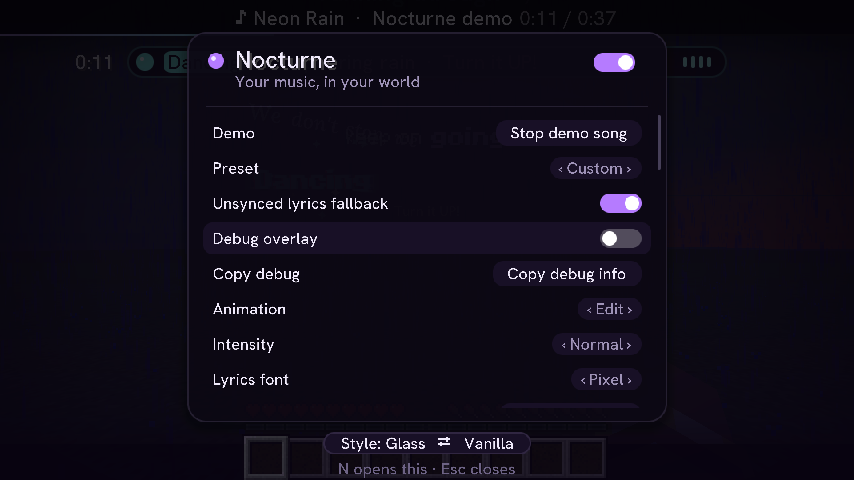

<div align="center">


[Download](https://github.com/Truwty/nocturne/releases) · [Issues](https://github.com/Truwty/nocturne/issues) · [Licensing](PORTING-NOTICE.md)

</div>

Cinematic world lyrics for **Minecraft Java 26.1.2 + Fabric**, entirely client-side. Nocturne automatically detects music playing on your desktop. **No Spotify login, developer application, Client ID, or API token is needed.**



## Install

1. Install Minecraft **26.1.2**, **Java 25**, **Fabric Loader 0.20.1+**, and [Fabric API 0.155.3+26.1.2](https://modrinth.com/mod/fabric-api/versions?g=26.1.2).
2. Put `nocturne-0.4.0-beta.1.jar` from [Releases](https://github.com/Truwty/nocturne/releases) in the instance's `mods` folder. Remove older Nocturne or Kangetsu Lyrics JARs from that instance first; keep one lyric mod installed.
3. Start Spotify or another supported desktop music player and play a song.
4. Press **N** in-game, or click **Nocturne** on the title screen. The default settings interface is Glass. The key can be rebound in Controls.

No server mod is required. Nocturne draws local visuals; it does not stream music. A server's own rules still apply. Hypixel compatibility has not been tested directly.

## Lyrics and effects

- Seven placements: scattered around you, ahead, following, sky, clouds, automatic placement, and moving drift.
- Eight animations: Edit, Karaoke, Typewriter, Wave, Drop, Glitch, Rise, and Zoom.
- Twelve visual presets including Custom, Music edit, Chill, Hype, Minimal, Neon, Retro, Bouncy, Dreamy, Sky, Battle, and Album.
- Smooth, Elegant, Impact, and Pixel fonts; configurable colours, glow, chromatic split, sparkles, impact shake/flash, cinematic bars, beat pulse, next line and song intros.
- World geometry rendering, optional visibility through walls, floor placement, battle words, front-view orbit, cloud effects and rain tinting.
- Both Glass and vanilla-style settings, timing adjustment, diagnostics, and a rescan action.
- Shader-compatible projected lyric rendering is available under Shader support. Third-party shader-pack compatibility is not guaranteed.

The included **Play demo song** action animates original demonstration text without playing audio. Use it to check visual effects independently of player detection or lyric coverage.


## Automatic music detection

On **Windows**, the bundled PowerShell helper reads Windows media sessions. It prefers playing Spotify, then another playing session, then paused Spotify/current-session fallback. No Python installation or frozen native executable is needed. If no music is found, start playback in the desktop app and use **Rescan desktop players** in settings.

On **macOS**, the existing Spotify and Music application integration uses AppleScript; macOS may ask for permission to control those apps. On **Linux**, install `playerctl` and use a player exposing MPRIS metadata. Windows has been tested locally; macOS and Linux integrations have not been validated in this release.

Lyrics are looked up separately through LRCLIB and the upstream lyric-search fallback. Detection does not provide Spotify's own lyrics. Availability, matching and synchronization depend on the catalog and the metadata exposed by your player. Unsynced fallback lyrics have estimated timing. Album-based colours need artwork metadata; the current Windows helper does not supply album artwork.

Nocturne sends track metadata to lyric services for lookup. It stores settings in `config/nocturne.json`. It never asks for or stores Spotify credentials, starts an OAuth callback server, or opens a Spotify authorization page.

## Changes from previous Nocturne releases

Version 0.4 replaces the previous Nocturne player implementation with the permitted Kangetsu-derived 26.1.2 port. Its focus is the original world lyric effects. The older transport controls, local-LRC library, six-theme player and settings format are not included in this replacement. Previous releases remain available from their existing tags.

The mod name, package, resource namespace, key category, config file, menu labels, icon and media helper namespace are Nocturne. Original copyright, font licenses and attribution are preserved. See [porting and licensing](PORTING-NOTICE.md); this version is **not wholly MIT licensed**.

## Build and test

With Java 25 configured as `JAVA_HOME`:

```powershell
./gradlew.bat build
./gradlew.bat runClientGameTest
```

The build runs eight unit tests covering lyric timing and credential-free media-session parsing. The client game test creates an isolated world and checks world-geometry submission, the rain hook, seven placements, four fonts, HUD fallback, and both settings interfaces. See [validation](VALIDATION.md).
