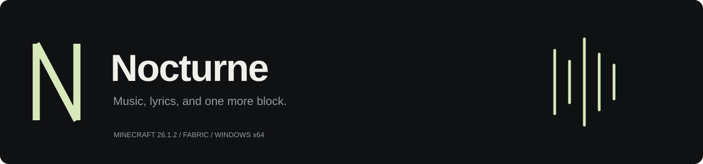
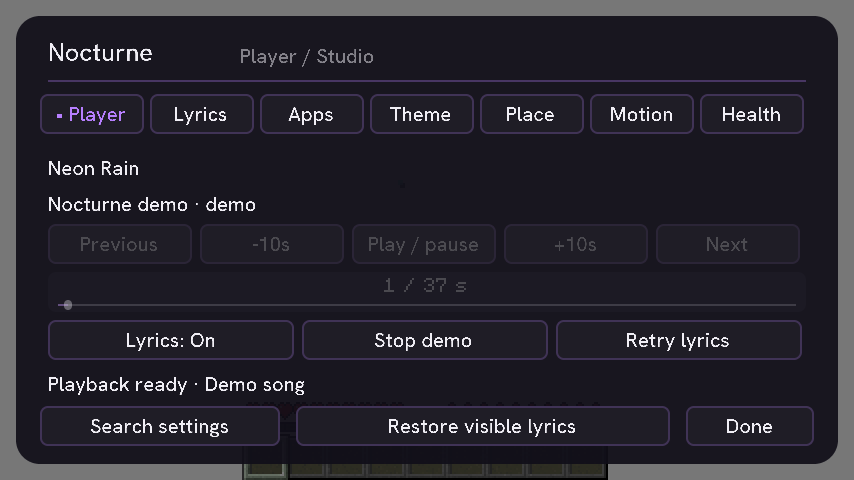
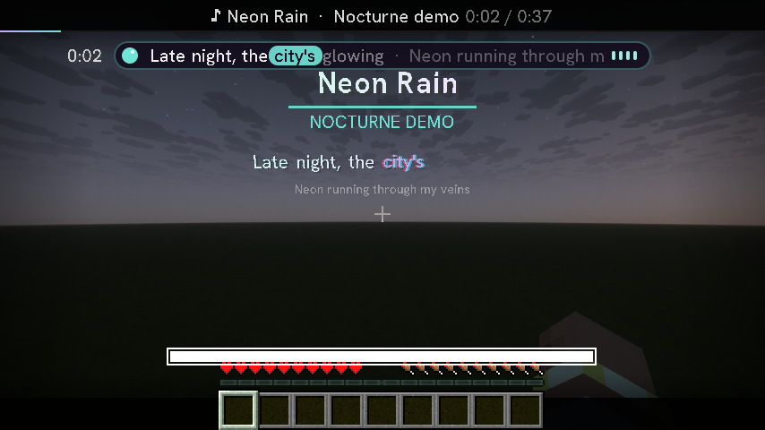
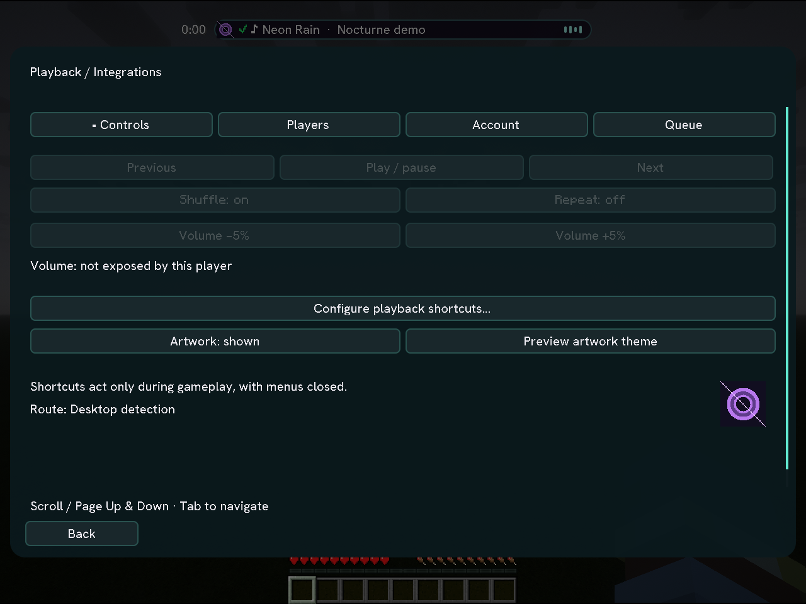
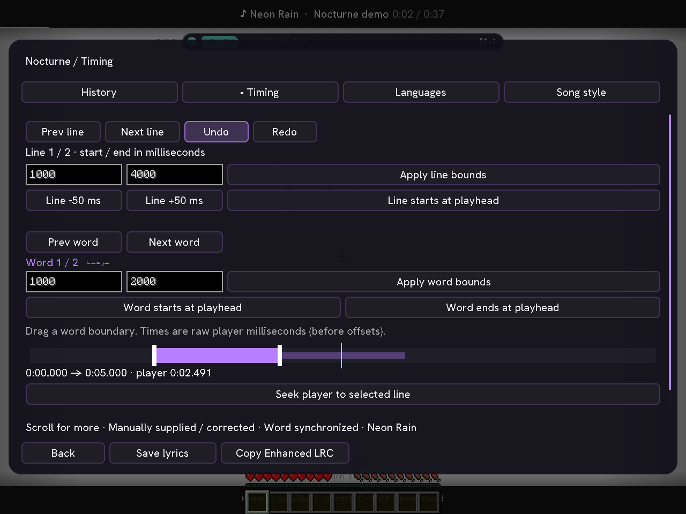
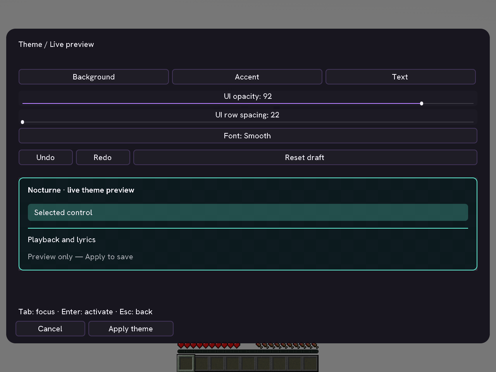

<div align="center">



[Download](https://github.com/Truwty/nocturne/releases) · [Issues](https://github.com/Truwty/nocturne/issues) · [Licensing](LICENSE)

</div>

Cinematic world lyrics and desktop music controls for **Minecraft Java 26.1.2 + Fabric**. Entirely client-side, with automatic desktop music detection. **Desktop detection needs no Spotify login or developer application.** An optional Spotify account connection adds device volume and queue controls.



## Install

1. Use **Minecraft 26.1.2**, **Java 25**, **Fabric Loader 0.20.1+**, and [Fabric API 0.155.3+26.1.2](https://modrinth.com/mod/fabric-api/versions?g=26.1.2).
2. Replace older Nocturne JARs with `nocturne-0.10.0-beta.1.jar` from [Releases](https://github.com/Truwty/nocturne/releases). Keep one version in the instance's `mods` folder.
3. Play music in your desktop app. Press **N**, or click **Nocturne** on the title screen, to open Studio.

No server installation is needed. Hypixel itself has not been directly tested; follow the server's own mod rules.

## Recovery, caching and playback

Player diagnoses lookup failure, playback-clock drift and hidden placement separately. The recovery button changes to Retry lyric lookup, Resync playback, Enable lyrics or Reconnect player as appropriate; healthy playback keeps Restore visible lyrics available. Intros and advertisements are not treated as placement failures. Provider timing can still need manual calibration in Lyrics.

Downloaded lyrics and their word timings persist in `config/nocturne/cache/lyrics` across launches. Expiry defaults to 30 days and is adjustable from 1–90 days in Health/advanced settings. The disk cache is bounded to 256 entries / 64 MiB; corrupt entries are preserved separately and fetched again. Retry lyrics bypasses both memory and disk for the current automatic match. Manual corrections remain separate and take priority; Use automatic lyrics again clears that override.

Matching removes remaster/feature/browser noise, extracts artist/title pairs from browser titles when artist metadata is absent, preserves live/acoustic/remix intent and rejects ambiguous artists. If metadata is insufficient, use the alternative-match picker rather than expecting an exact automatic match.

Seeking, pause/resume, track changes, recognized advertisements, session loss and Windows output-device changes reset the lyric clock and stale effects. Health has an explicit resynchronization action. Windows Apps diagnostics show each detected app's advertised play/pause, seek and next/previous support. macOS/Linux display detected apps but explicitly mark per-action capability details unavailable.

Settings use schema version 1. Legacy settings are backed up before migration, unknown settings are preserved, corrupt JSON is quarantined, and valid backups are restored when available. Damaged libraries similarly recover from backup or start safely after preserving the damaged original. Health reports recovery and write failures. Future config versions are read-only to prevent downgrades from overwriting them.

## Tested compatibility

The local suite exercised Adrenaline 26.5.1 and Fabulously Optimized 13.6.0 client configurations, Derivative 25.1.0 and Complementary Reimagined r5.9.3 shader packs, Stratum 128x Build 59, GUI scales 1–4, resource reloads and world reconnects. These runs use Nocturne's pinned Fabric Loader/API and Iris/Sodium versions; see [the exact test matrix and limits](VALIDATION.md). External pack files are not bundled or redistributed.



## If a song is detected but lyrics are missing

Press **N → Player → Retry lyrics** to fetch again. The context-sensitive recovery button offers the appropriate action; **Restore visible lyrics** resets the transform, follows your view, enables through-wall display, and selects the compatible projected renderer. Both controls are on the main player page. No config deletion is needed.

The player page shows the lyric lookup status. Search alternatives or import a local LRC in Lyrics when the providers do not have the track. This release rejects invalid Windows timestamps, retries misses, refreshes lyrics when track duration arrives late, and bounds individual lookup time. Valid sparse timeline updates still advance normally.

## Studio

The seven tabs bring playback, lyric correction and visual editing into one interface. Small windows use scrolling; the coloured scrollbar and Scroll hint indicate additional controls. Search settings opens the complete settings catalog with category filters and search across names, categories and descriptions. Buttons and sliders use native Minecraft focus, narration and tooltips, with reduced-motion support.

### Player and apps

Play/pause, next/previous, ±10-second seeking and a draggable timeline control the existing desktop player. Controls are disabled when that player does not advertise support, or while the visual demo is active. Rejected commands appear as a status message.

Auto chooses playing sessions first, then your ordered app-name priorities, keeps the current app on equal priority, and finally sorts by app ID. The **Apps** tab lists detected desktop sessions. Pin a player to retain that selection, including while it is closed; Nocturne reconnects when it returns. Auto clears the pin. Reconnect restarts the media helper with the pin preserved.

Windows uses the bundled PowerShell/Windows media-session helper; no Python installation is required to use the mod. macOS uses Spotify/Music AppleScript integration and may require OS automation permission. Linux requires `playerctl` and MPRIS. Windows is validated locally; macOS/Linux transport integration remains unverified.

### Playback and integrations



Open **N → Player → Playback & integrations**. Configure nine optional playback bindings in Minecraft's **Options → Controls → Key Binds → Nocturne**: play/pause, previous/next, seek ±10 seconds, player volume ±5%, shuffle and repeat. They start unbound and only fire with a world open and menus closed. They send local player commands, never server chat or gameplay packets.

The **Controls** page shows artwork, volume, shuffle and repeat. Unsupported actions stay disabled; Windows media sessions support shuffle/repeat only when the app advertises them. Windows sessions do not expose queues or per-device volume, so these require the optional Spotify account route. macOS/Linux adapters currently expose transport controls only. Album covers come from the player's artwork URL or a matched Apple catalog result; missing artwork leaves the existing HUD icon. Downloads are limited to 4 MiB, decoded images to 2048² pixels, and uploaded textures to 128². **Preview artwork theme** opens a color draft; Apply saves it, Back cancels it.

The **Players** page edits comma-separated app-name priorities (case-insensitive substring matching), resets defaults, or pins a detected app. Playing status outranks the list. A pin always wins and waits while that app is closed. Connecting an account alone does not switch playback away from desktop detection.

The **Account** page provides optional [Spotify PKCE authorization](https://developer.spotify.com/documentation/web-api/tutorials/code-pkce-flow). Create your own app in the [Spotify developer dashboard](https://developer.spotify.com/dashboard), register the exact redirect `http://127.0.0.1:43869/callback`, enter its **public Client ID**, and choose Connect. No client secret is requested. After authorization, choose **Use Spotify account** and start playback on a Spotify device. Spotify playback permissions may require Premium and account access to that developer app; a 403 response explains this in the interface. Select **Use desktop detection** to return at any time.

The **Queue** page loads up to 50 upcoming items, paginates them, skips the current track, and appends a `spotify:track:…` or `spotify:episode:…` URI. Spotify exposes no queue reordering/removal endpoint; those actions are not offered. Queue access requires the account route and an active supported device. Account volume targets that device, not Windows master volume.

Credentials are stored separately under `config/nocturne/private`, encrypted with AES-GCM and restricted to the current filesystem owner. The encryption key is in that same private directory; this is local file protection, not an OS credential vault. Credentials never enter presets, general settings, diagnostic reports or exports. Disconnect deletes the local credential files; you can also revoke app access in Spotify. Network work runs on a dedicated worker, honors rate-limit retry delays, and expires stale playback state. Browser login listens only on IPv4 loopback, verifies state and PKCE, and times out after five minutes.

### Lyric correction

The **Lyrics** tab searches LRCLIB for alternative synchronized matches. Select a result to keep that correction for the current song. If the song changed during a search, selection is rejected to avoid saving the wrong correction.

Import a UTF-8 `.lrc` or enhanced-LRC file by entering its full path and choosing **Import**. Files must be at most 1 MiB and contain timestamps. Imports and chosen matches take priority over online lookup and work offline. **Use automatic lyrics again** removes that song's override.

**Earlier / Later / Reset offset** saves a separate timing adjustment for each song. Positive offsets show lyrics earlier. The original global offset remains available under Detailed settings.

Lyrics are stored as hashed track identifiers under `config/nocturne/lyrics/`. Presets, offsets and the pinned player are kept in `config/nocturne/library.json`; general settings remain in `config/nocturne.json`. Writes use temporary files and atomic replacement when supported. A malformed library is preserved and recovered from a valid backup where available; Health reports recovery or blocked writes.

### Lyric workspace



Open **N → Lyrics → Lyric workspace**. Its four tabs provide:

- **History:** browse previous/upcoming lines, follow the current playback line, and open a line in the timing editor.
- **Timing:** edit line and word start/end timestamps in milliseconds, shift lines ±50 ms, tap boundaries to the raw player position, or drag the selected word's handles on the playback timeline. Gold marks the playhead. Undo/redo retains 40 edits; **Save lyrics** persists the document for this track. Seeking is available only when the desktop player supports it. Scroll to reach all controls on smaller GUI scales.
- **Languages:** independently toggle optional translation and romanization lines beneath the world display. Available provider language layers are retained. Import synchronized UTF-8 LRC sidecars for either language layer; lines match within 500 ms. Missing translations are left empty. These controls do not call a machine-translation service.
- **Song style:** save the current placement, font, size, colours and effects for this song. Profiles apply automatically on track changes; the global appearance is restored afterward and remains separate when settings are saved. Save the profile again after editing it, or remove it to return to global appearance.

Word karaoke uses source timestamps from Enhanced LRC, the LRCLIB `lyricsfile` field ([Lyricsfile 1.0 draft](https://github.com/tranxuanthang/lyricsfile/blob/main/SPECIFICATION.md)), or NetEase YRC/KLYRIC when supplied. Legacy line-only LRC and unsynchronized text retain **estimated word timing**, shown explicitly in the confidence label. Manually imported/corrected documents and mixed timing are labelled separately. Providers do not offer word timing or secondary languages for every song.

Enhanced LRC imports, the renderer, local documents and the editor preserve timed text segments, including spaces and multilingual segments. **Copy Enhanced LRC** exports timing text to the clipboard. The local JSON document additionally retains independent word ends, language layers and provenance; Enhanced LRC cannot represent every overlapping end time. Estimated exports include Nocturne provenance headers so reimport does not silently upgrade estimates to source timing. Translation/romanization each have a separate LRC clipboard export.

Text uses bidirectional shaping independently of Minecraft's UI language. The Unicode lyric font uses Minecraft's broad Unifont fallback for Arabic, Hebrew, CJK and other scripts; actual glyph coverage still depends on installed resource packs. Word layout follows visual bidirectional order while timing retains logical word indices. Optional vocal countdowns cover known intros/instrumental gaps; no gap is invented when the source has only continuous line timing. Confidence and countdown switches are in Languages or Advanced settings.

Edited documents and secondary layers survive restarts under the hashed song identifier in `config/nocturne/lyrics`. **Use automatic lyrics again** clears the primary manual override but retains optional language sidecars. Closing the workspace does not auto-save timing edits: use **Save lyrics** first.

### Theme preview and full color picker

**N → Theme → Live theme editor** opens a draft. Background, accent, text, opacity, spacing and font are shown in a live sample; the applied theme and saved settings remain unchanged until **Apply theme**. **Cancel** discards the draft. Midnight, Lagoon and Ember buttons also open previews before applying.



[Color picker screenshot](docs/interface-picker.png). Each color opens a saturation/brightness square, hue, saturation, brightness and opacity sliders, an alpha checkerboard and validated **#RRGGBB / #AARRGGBB** input. **Read hex** previews entered text; **Use color** returns it to the theme draft. The twelve most recent distinct colors persist across launches. All channels also have keyboard/controller-accessible sliders. The hue control uses degrees; opacity and other channels use percentages.

Draft **Undo/Redo** and **Ctrl+Z / Ctrl+Y / Ctrl+Shift+Z** retain up to 60 changes. Applied themes have separate Undo theme / Redo theme controls on the Theme tab. Theme preview renders a sample rather than temporarily replacing global settings, so unrelated saves cannot persist an uncommitted preview.

### Search and preset browser

**Search settings** is always available in Studio's footer. Search by name, category or description, then filter by Lyrics & playback, Appearance, Placement, Motion & performance or Interface. Six results per page keep controls accessible. UI theme rows open the draft preview; numeric settings use sliders, colors open the picker, and toggles/modes/actions use native buttons. Hover or focus a control for its description and range.

Theme, placement and HUD preset browsers provide name search, visual previews, persistent favorites, Save current, clipboard JSON import/export and Reset preview. **Apply preset** is separate from selection/import/reset. Imports are limited to 64 KiB and validate schema, category, value types, modes, ranges and colors before changing settings. Placement previews are schematic; the world editor provides the live game preview. Built-in palettes remain available without creating a named preset.

### World placement and HUD layouts

**N → Place → Edit in world** edits the world lyric transform. Drag to move, rotate or resize; right-drag changes roll and the wheel changes distance. Mouse drags are single undoable operations. Use the native Undo/Redo buttons or Ctrl+Z / Ctrl+Y. Alt+arrows or the controller's right stick nudge the selected transform mode. Each placement mode retains its own active transform profile; preset browsers provide additional named/shared slots.

**N → Place → Drag HUD / gameplay & menu layouts** edits the karaoke/player bar, secondary language lines, vocal countdown, confidence and diagnostics. Drag a widget, toggle its visibility, change its scale, or align it to safe edges and the screen center. Snapping uses an 8-pixel grid plus screen/neighbor edges and centers, with live alignment guides. Elements are clamped to an 8-pixel safe margin and fit the viewport at different GUI scales. Dynamic text widths can change the box size while retaining its saved center.

**H / Hide controls** temporarily hides the editor panels so elements underneath them can be dragged. **Alt+arrows** nudge by a pixel; Shift increases the step to ten pixels. The right stick also nudges the selected widget. Undo/Redo, Reset, visibility and scaling edit the draft; **Save layouts** saves both layout contexts. Cancel/Escape discards unsaved drafts.

Gameplay and Menu layouts keep independent positions, scales, visibility and undo histories. Gameplay is used with no open screen; Menu is used whenever a screen is open, including the main menu when desktop metadata is available. Menu widgets default to hidden. Feature switches such as Karaoke bar, Show translation and Debug overlay still control whether content is available. The cinematic letterbox remains a full-screen decoration, and world/projected lyric placement remains in the separate world editor.

HUD presets have an explicit **Target: Gameplay / Menu** control. Applying a preset from inside the HUD editor updates its draft; Save layouts is still required. Presets opened directly from Studio apply to the selected saved context. Recent colors, favorites, presets and layouts are stored under their own groups in `config/nocturne/library.json`.

### Keyboard and controller navigation

Tab / Shift+Tab moves native focus; Enter/Space activates buttons. Arrow keys adjust focused sliders; Enter toggles slider editing. Page Up/Down or scrolling reaches additional controls at small GUI scales. New editor buttons and sliders include hover/focus tooltips. Theme and placement history shortcuts avoid stealing text-field input.

Nocturne includes navigation for [GLFW standard gamepads](https://www.glfw.org/docs/latest/input_guide.html#gamepad): D-pad up/down or the left stick moves focus; left/right adjusts/navigates; A activates, B goes back, bumpers scroll, X undoes and Y redoes. The right stick nudges HUD/world placement in the corresponding editor. Input is limited to Nocturne screens and has dead zones, repeat delays and screen-transition suppression. **Controller navigation** can be disabled in Theme/search. Native polling yields to Controlify or MidnightControls when installed to avoid duplicate input; those mods can also provide text entry. The built-in navigation does not add an on-screen keyboard or control Minecraft gameplay.

Controller action dispatch/repeat behavior is automated-tested. Physical gamepad hardware has not been validated locally; mapping availability depends on the device, OS and GLFW mapping database.

### Motion, performance and accessibility

- Independent flash and shake switches, both off by default.
- Reduced motion suppresses flash, camera beat zoom, animated styling, particles and ambient animation.
- High-contrast lyrics use white text with a dark readability treatment; the lyric size control supports larger text.
- Lightweight, Balanced and Ultra quality levels change glow passes and cap particles at 20, 48 and 180 respectively. Additional particle limits and distance/behind-camera culling bound effects work.
- Apply lightweight preset disables expensive glow/chromatic/cloud drift effects together.

The original world effects remain: seven placements, eight animations, twelve visual presets, five lyric fonts (including Unicode), chromatic split, sparkles, cinematic bars, battle words, cloud lettering, optional through-wall rendering and rain tinting.

### Optional audio reaction

**Desktop audio reactive** is opt-in and Windows-only. It reads the actual peak level of the default output device using [Windows Core Audio](https://learn.microsoft.com/en-us/windows/win32/api/endpointvolume/nn-endpointvolume-iaudiometerinformation), then smooths it into lyric scale pulses. Adjust Audio sensitivity to suit the output level.

This meter includes **all sound on that output**, including Minecraft and notifications. It does not isolate Spotify, detect BPM, use the microphone, record audio, or transmit audio. Health reports when the output meter is unavailable. Reduced motion suppresses audio-driven movement. With audio reaction off, the original lyric-timing pulse remains available.

## Coverage and privacy

Automatic detection reads metadata published by desktop players; it does not obtain Spotify's own lyric feed. Live lyric availability and synchronization depend on external catalogs. Unsynchronized fallback has estimated timing. The demo animates original text without playing audio.

Track metadata is sent to lyric/artwork providers for lookup (LRCLIB, the upstream NetEase fallback and Apple's artwork catalog). Imported local lyrics bypass lyric lookup; artwork lookup is separate. Audio metering stays local. No Spotify credentials are requested or stored.

Shader-compatible projected text is available in Detailed settings. Automated tests exercise vanilla, Sodium 0.9.2 and Iris 1.11.4 with Minecraft 26.1.2. An Iris test without a shader pack does not establish compatibility with every shader pack.

## Build and test

With Java 25 as `JAVA_HOME`:

```powershell
./gradlew.bat build
./gradlew.bat runClientGameTest
./gradlew.bat runClientGameTest -Pcompat=sodium
./gradlew.bat runClientGameTest -Pcompat=iris
```

Compatibility dependencies are pinned and used only with the requested Gradle property; they are not bundled in the release. GitHub CI runs unit/build checks and a four-profile client test matrix with a virtual display.

The optional Windows transport test creates and controls only its own muted media session:

```powershell
python -m pip install -r scripts/media-test-requirements.txt
python scripts/windows_media_smoke.py
```

Those Python dependencies are for developer tests only. See [validation](VALIDATION.md) for the tested behavior and limits.
