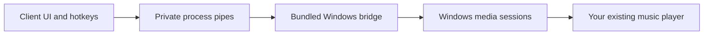

<div align="center">


**Your soundtrack. Your world.**

A client-only music cockpit for **Minecraft Java 26.1.2 + Fabric**, on **Windows x64**.

[Download](https://github.com/Truwty/nocturne/releases) · [Report a bug](https://github.com/Truwty/nocturne/issues) · [MIT license](LICENSE)

</div>

## What it does

- A dark cockpit with mint and violet accents, album art, live progress, and playback controls.
- Compact music HUD with four corner positions, idle hiding, and reduced motion.
- Play/pause, previous/next, click-to-seek, and selection between desktop media sessions.
- Press **N** in game, or click **Nocturne** at the top right of the title screen.
- Rebind all controls in **Options → Controls → Key Binds → Nocturne**. Transport hotkeys are initially unbound to avoid conflicts.
- One JAR, with its Windows media bridge included. No Python install, account login, API key, local server, or Spotify Premium API is required.

## Install

1. Use **Minecraft Java 26.1.2**, **Java 25**, and **Fabric Loader 0.20.1 or newer**.
2. Install [Fabric API 0.155.3+26.1.2](https://modrinth.com/mod/fabric-api/versions?g=26.1.2).
3. Download `nocturne-0.1.0-beta.1.jar` from [Releases](https://github.com/Truwty/nocturne/releases) and put it in the instance's `mods` folder.
4. Start Minecraft. Play a track in your desktop music app, then open Nocturne.

This beta supports **Windows 10 1809+ / Windows 11, x64 only**. Windows ARM, Linux, and macOS are not supported by the bundled bridge. Nocturne displays a diagnostic instead of starting it on unsupported platforms.

## Music app compatibility

Nocturne uses [Windows System Media Transport Controls](https://learn.microsoft.com/en-us/uwp/api/windows.media.control.globalsystemmediatransportcontrolssessionmanager). An app must publish a Windows media session. It controls your existing player; it does not stream music itself.

| Player | Requirements and limits |
| --- | --- |
| Spotify desktop | Media-session integration enabled; local metadata/artwork verified during development. Controls depend on Spotify's advertised capabilities and account restrictions. |
| Apple Music / Cider | A version that publishes a Windows media session. Not independently tested in this beta. |
| YouTube Music | A desktop wrapper with SMTC support, or a browser publishing media sessions. May appear as Chrome/Edge rather than the service name. Not independently tested. |
| TIDAL | Windows app with media-session support. Not independently tested. |
| foobar2000 | Requires an SMTC integration component. Not independently tested. |
| Other players | Any compatible Windows media session may work. |

Unavailable controls are disabled. Some services omit duration, album artwork, or seeking. Protected content and ads may reject a command. The source selector cycles through **Auto select → each app → Auto select**; a manually selected missing app stays idle instead of unexpectedly controlling another player.

The animated bars are decorative playback indicators, not an audio spectrum analyzer. Album artwork comes from your player; no remote images are fetched.

## Multiplayer and Hypixel

The mod declares `environment: client`. There is no server entry point, server installation, networking channel, gameplay automation, chat command, or packet modification. Only local UI, hotkeys, media metadata, and desktop playback are involved.

This does **not** establish Hypixel approval or ban safety. Check the server's current allowed-modification policy and supported Minecraft versions. Nocturne does not provide a protocol translator, bypass, or a way to join a server that does not accept Minecraft 26.1.2. Multiplayer/Hypixel testing has not been performed for this beta.

## Privacy and troubleshooting

The bridge communicates only over private stdin/stdout pipes with Minecraft. It opens no TCP port and requests no service credentials. It can read metadata for your desktop's media sessions, as needed for app selection and display. Nothing is uploaded by Nocturne.

The native executable is extracted to `config/nocturne/runtime/<sha256>/nocturne-bridge.exe` and checked against the JAR's embedded hash before execution. It exits when Minecraft closes its pipe. Settings live in `config/nocturne.json`.

- **No track:** start playback in a compatible app and cycle Source back to Auto select.
- **Wrong player:** use Source to select the intended app.
- **Grey control:** the app does not advertise that action.
- **Bridge stopped:** click Reconnect; inspect `logs/latest.log` for details.
- **Antivirus flags the unsigned bridge:** this beta's PyInstaller executable is unsigned. Inspect/build the source or wait for review; do not disable security software.

## Build from source

Use Windows x64, JDK 25, Python 3.14 x64, and Git. The checked-in Gradle wrapper downloads Gradle 9.8.2. No Minecraft binaries are distributed in this repository.

```powershell
git clone https://github.com/Truwty/nocturne.git
cd nocturne
./scripts/build-windows.ps1
./gradlew.bat runClient
```

The build script creates a local `.venv`, installs pinned bridge dependencies, runs bridge tests, builds the included executable, and runs the Java build/tests. Find the installable JAR in `build/libs/`; the `-sources.jar` is for developers.

## Architecture



The game thread never waits for native API calls. One background Java reader receives immutable snapshots; Windows operations have timeouts. Album textures are replaced and released on the client thread.

## Status and attribution

**Early beta, not a claim of perfect compatibility.** See [VALIDATION.md](VALIDATION.md) for what was actually tested and the remaining checks.

Inspired by the idea of [Craftify](https://modrinth.com/mod/craftify), by ThatGravyBoat and VindoCel. No Craftify source, artwork, or branding is included. Nocturne is an independent MIT-licensed implementation and is not affiliated with Craftify, Mojang, Microsoft, Spotify, Apple, TIDAL, Google, or Hypixel.

The Windows bridge bundles Python (PSF), PyWinRT (MIT), and the PyInstaller bootloader (GPL with a distribution exception). See [THIRD_PARTY_NOTICES.md](THIRD_PARTY_NOTICES.md).
