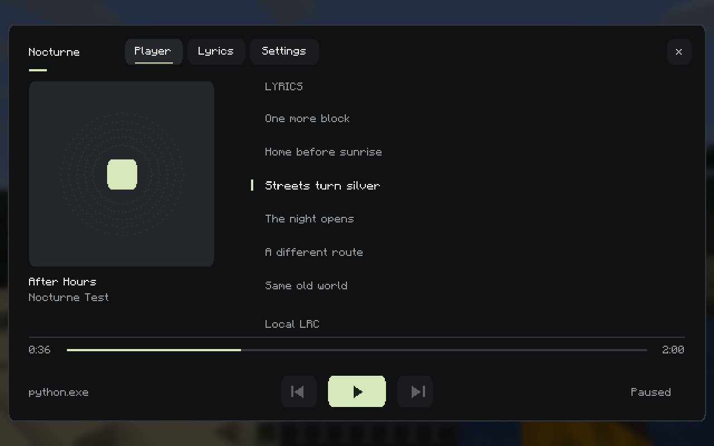
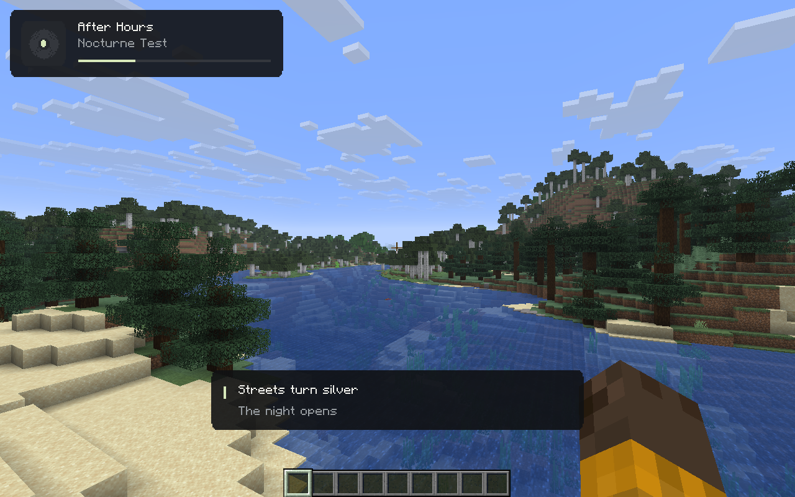
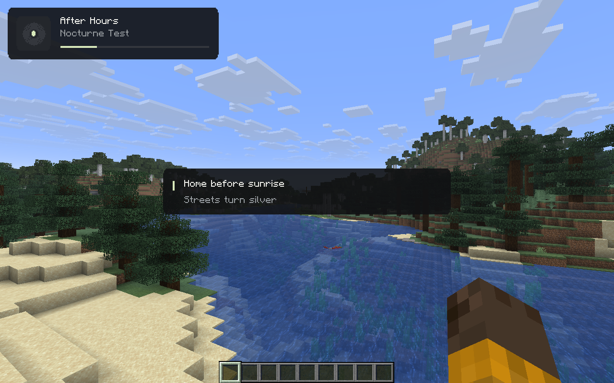

<div align="center">


[Download](https://github.com/Truwty/nocturne/releases) · [Issues](https://github.com/Truwty/nocturne/issues) · [MIT license](LICENSE)

</div>

Music controls and synced lyrics for **Minecraft Java 26.1.2 + Fabric**, **Windows x64**, entirely client-side.



## What's new in 0.2

- **Synced lyrics:** automatic LRCLIB lookup, a scrolling lyric view, and click a line to seek.
- **Three lyric overlays:** centered subtitles, a side panel, or a local world pin five blocks ahead of you.
- **Six themes:** Graphite, Paper, Ember, Moss, Rose, and an album-derived accent palette.
- **Smoother motion:** frame-rate-independent scrolling and hover transitions, artwork reveal, active-line emphasis, and reduced motion.
- **Practical controls:** drag-to-scrub, timing adjustment, lyric size, opacity, HUD corner, idle hiding, and separate music/lyrics visibility.
- **Local/offline lyrics:** LRC and enhanced LRC files, persistent cache, and a switch that disables online lookup.
- **Better app selection:** Auto prefers music over speech/call sessions and retains a paused player. Manual selection stays on that app.

## Install

1. Use **Minecraft Java 26.1.2**, **Java 25**, and **Fabric Loader 0.20.1+**.
2. Install [Fabric API 0.155.3+26.1.2](https://modrinth.com/mod/fabric-api/versions?g=26.1.2).
3. Put `nocturne-0.2.0-beta.1.jar` from [Releases](https://github.com/Truwty/nocturne/releases) in the instance's `mods` folder. Replace the older Nocturne JAR; keep one version installed.
4. Play music in your desktop app. Press **N** in game, or click **Nocturne** on the title screen.

The Windows media bridge is bundled. No Python installation, account login, or service credentials are needed. Supported OS: Windows 10 1809+ / Windows 11, x64. Linux, macOS, and Windows ARM are not supported by this beta.

## Lyrics

The **Player** tab shows lyrics beside the album. **Lyrics** opens the larger view. Scroll to browse; it returns to the current line after four seconds. **Follow** resumes tracking immediately. Click a timestamped line to seek, when the player permits seeking. Drag the timeline to scrub.

Adjust timing with **-0.1s / +0.1s / Reset**, or **[ / ]**. Positive offset displays lyrics earlier. The saved offset is global. **Reload** re-reads a local file or retries an unavailable lookup.

Under **Settings → Appearance**, choose a theme, reduced/smooth motion, opacity, lyric size, and subtitle/side/world layout. **Settings → Controls → Pin lyrics in world** places a camera-facing lyric display at a local point five blocks ahead. Re-pin to move it. Pins last for the current world session and are hidden behind solid collision blocks. They use camera projection and a local visibility raycast; they are not a depth-tested 3D text mesh.

All music hotkeys, lyric visibility, and world pinning can be rebound in **Options → Controls → Key Binds → Nocturne**. Optional hotkeys start unbound to avoid conflicts.





### Coverage and timing

Online lyrics come from [LRCLIB](https://lrclib.net/docs), independently of your music provider. Matching uses title, artist, album, and duration. A fallback catalog search accepts the same title/artist only when duration differs by at most two seconds. Missing tracks, instrumentals, unsynced lyrics, and network errors have separate states.

**Lyrics are not available for every song.** Windows does not provide Spotify's own lyric feed. Plain lyrics stay unsynced. Word highlighting requires actual enhanced-LRC word timestamps in a local file; ordinary line-synced responses are highlighted by line. No timing is fabricated.

### Local LRC files

Place a UTF-8 file in `config/nocturne/lyrics/`, named:

```text
Artist - Track Title.lrc
```

Windows-invalid filename characters are replaced with `_`; each artist/title component is capped at 70 characters. Use the exact title and artist reported by the player, then press **Reload**. Local files override online/cached lyrics and work with online lookup disabled.

Original example:

```lrc
[00:00.00]Window light
[00:08.00]City quiet
[00:16.00]One more block
[00:24.00]Home before sunrise
```

Enhanced LRC is also supported, for example `[00:00]<00:00>Window <00:02>light`. LRC metadata offsets and repeated line timestamps are supported.

## Music players

Nocturne controls existing [Windows media sessions](https://learn.microsoft.com/en-us/uwp/api/windows.media.control.globalsystemmediatransportcontrolssessionmanager). It does not stream music itself.

| Player | Requirements |
| --- | --- |
| Spotify desktop | Windows media-session integration. Metadata and artwork verified locally. Controls depend on the capabilities advertised by Spotify. |
| Apple Music / Cider | A Windows version exposing a media session; not independently tested. |
| YouTube Music | A compatible desktop wrapper or browser media session; not independently tested. |
| TIDAL | Windows media-session support; not independently tested. |
| foobar2000 | An SMTC integration component; not independently tested. |
| Other apps | A compatible Windows media session. |

Unavailable controls are disabled. Some apps omit artwork, duration, or seeking. Source selection cycles Auto → each app → Auto. A manually selected app disappearing never causes a command to be sent to a different app.

## Privacy and files

**Online lyrics are enabled by default.** To find a song, Nocturne sends its **title, artist, album, and duration** to `lrclib.net`; that service also sees your normal connection/IP. No account information, tokens, audio, world data, or server information is sent. Turn off **Settings → Controls → Online lyrics** to use local files/cache only; pending lookup is cancelled.

The native media bridge uses private process pipes and opens no network port. Artwork comes from the desktop app. The JAR's bridge is hash-checked and extracted to `config/nocturne/runtime/<sha256>/`. Lyrics cache is under `config/nocturne/lyrics/cache/` (up to 64 records; seven-day freshness for online lookup). Original user-provided LRC files are never pruned. Settings are in `config/nocturne.json`.

## Multiplayer

Nocturne declares `environment: client`, has no server entry point or custom networking channel, and does not automate gameplay or modify game packets. World lyric pins are local visual overlays.

Hypixel approval, ban safety, and acceptance of Minecraft 26.1.2 are **not established**. Check each server's current mod policy and supported client versions. Nocturne does not translate protocols.

## Build and validation

On Windows x64 with **JDK 25**, **Python 3.14 x64**, and Git:

```powershell
git clone https://github.com/Truwty/nocturne.git
cd nocturne
./scripts/build-windows.ps1
./gradlew.bat runClient
```

The script builds the bridge from source, runs Python/Java tests, and packages the JAR in `build/libs/`. Gradle and Python dependencies are pinned. [VALIDATION.md](VALIDATION.md) records tested behavior and remaining limits. The executable is unsigned; this is a beta.

## Credits

Inspired by [Craftify](https://modrinth.com/mod/craftify) and the [観月 Lyric showcase](https://www.youtube.com/watch?v=mw3MLXPYN3A). No source, artwork, or branding from those projects is included. LRCLIB and player-supplied lyrics/artwork retain their respective rights; they are not covered by Nocturne's MIT license. See [THIRD_PARTY_NOTICES.md](THIRD_PARTY_NOTICES.md).
