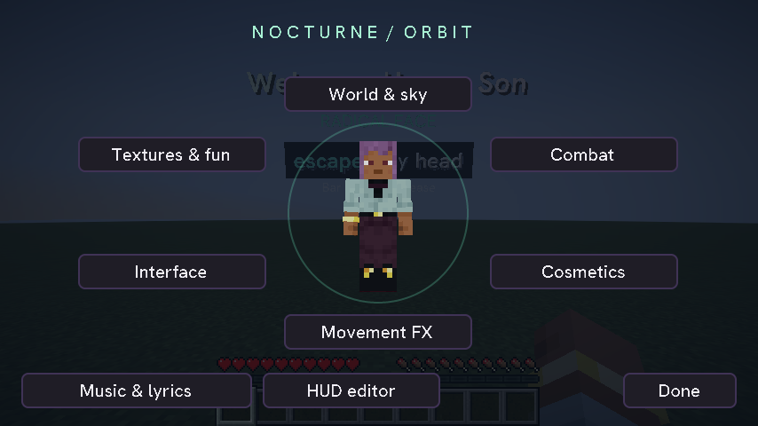
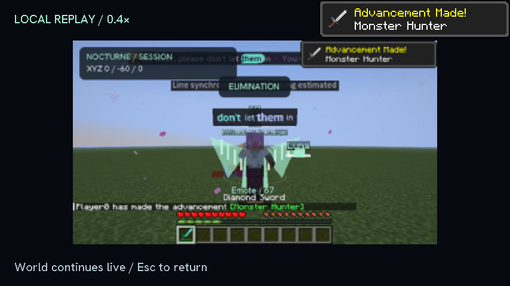

# Nocturne Experience suite

Development build: **1.1.0-alpha.2**, bundled into the existing client-only Nocturne mod. This implementation targets **Minecraft 26.1.2 / Fabric / Java 25**. The published 1.0.2 music release remains available; this branch is a preview and is not a replacement release for other Minecraft targets.



## Open it

- **O** opens Orbit around your player. **N** still opens music settings.
- **B** opens the emote wheel. **J** opens the local visual block palette.
- Hold **C** to zoom. Rebind these in Minecraft's Controls menu.
- Studio → Health → Orbit also opens the new modules.
- New modules start **off**, or use the server's original appearance. Each category has a reset button.

## World & sky

Six actual color-grading post effects: Nocturne, Cyberspace, Golden hour, Glacier, Rosewood and Monochrome. These are lightweight post effects, not shadow/reflection shader packs. Existing Iris packs and vanilla spectator effects take priority. Environment palettes also tint sky, fog and clouds.

Local dawn/noon/sunset/midnight, clear/rain/snow/blizzard/sandstorm/blossom/ash layers, spring/summer/autumn/winter vegetation tints and particles, aurora ribbons, shooting stars and firefly/enchant/cherry ambient particles are optional. Changes affect the client presentation; they do not set a server's time, weather, biomes or game rules.

Fog has close/balanced/distant/custom modes. Custom mode exposes distance and hue. Clouds have low/high/hidden/custom height modes. Changing a season rebuilds client tint caches once.

**HD rain and snow** are an optional original 128px resource pack. Select it under Orbit → Textures & fun → Animated textures. Blizzard and other particle layers have separate runtime limits from texture resolution.

## Combat

- Hit splashes: sparks, hearts, soul and rainbow dust; falling-hit critical bursts.
- Damage numbers from observed health loss after your attack.
- Tung Tung Sahur wooden mascot/mallet, Brainrot, Hearts, Bloom, Soul and randomized kill effects.
- Observed elimination/streak banners and bell/chime/bonk sounds.
- Mace impact rings and wind-charge trails.
- Local practice hologram: look at the target and attack; it never spawns a server entity.
- Eight styled death screens: Undertale, Wasted, Arcade, Cinematic, Starlight, Minimal, Glitch and Bloom. Vanilla cause of death, score, narration, respawn cooldown and hardcore behavior remain intact.

Effects use health updates from entities the client knows about after a local attack. This is **observed combat**, not server-certified damage or kill credit. Servers that hide health, use custom entities or remove targets immediately may not expose enough information. Unloading an entity alone never becomes a kill.

### Slow-motion replay

Optional first-person/viewpoint footage is captured into a bounded **40-frame, 320×180, memory-only buffer**. A short post-roll includes the visible kill moment. Playback runs at **0.4×** with blended adjacent frames; it replays the actual captured view, rather than reconstructing a world or another player's camera. Recording reduces capture frequency as frame time rises and allows only one readback in flight.

Choose Record only or Replay after kill. Watch recent footage from Combat. **The server continues live** during playback; Esc returns immediately, and taking damage closes the replay. Frames are never written to disk or transmitted. Changing worlds or disabling capture clears them.



## Cosmetics & movement

Local procedural capes, wings, top hat, horns, halo and crown; glass/ghost treatment of your own skin; star/heart/soul auras; named orb/sprite/star companions. They are local visuals, not a shared cosmetics service or replacement skin upload. Other players' skins and visibility are not changed.

The B wheel animates your own third-person model: 67, Wave, Bow, Celebrate, T-pose, Dance and Heart. Moving, taking damage or using an item cancels an emote. Reduced-motion settings suppress pose animation.

Floor trails, projectile trails, jump rings and landing shockwaves are independent switches. Particle spawning adapts to frame time and has a configurable 16–256 per-tick ceiling, with at most four times that many live owned particles. Photosensitivity/reduced-motion controls stop new particles and remove owned particles immediately. Meshes, captions, waves, kill visuals, holograms and tracked targets are bounded too.

## Interface & toys

- Orbit menu with your actual player preview, keyboard navigation and links to the existing music workspace and HUD editor.
- Optional skin-and-sword slash intro, once per title-session, plus a preview button and Esc skip.
- Session and Container widgets in the existing draggable HUD editor, including its snapping, alignment, undo/redo and gameplay/menu layouts. Older five-widget layouts gain the two new nodes without losing existing positions.
- Smooth hotbar selection, hold-to-zoom and colored block wire outlines.
- Held-container contents and **last-seen** chest contents, only after opening that chest normally. The latter is an eight-chest session cache, not live access to unopened inventories.
- Dropped-item timers are labeled estimates from client-observed age. Server-specific lifetimes and previously unloaded items cannot be known exactly.
- Nine optional original animated texture packs: Mint/Cyber/Amber, independently selectable for swords, totems and blocks. These replace selected vanilla textures; they do not add server items.
- J places up to 64 local glass holograms with undo/clear. They have no collision and are cleared on world changes.
- Fake Creative is an item catalog; it never grants items or abilities. Rage quit asks before disconnecting.
- Existing music detection, lyrics, karaoke, editing, themes and 57 lyric presets remain available.

## Discord Rich Presence

Optional Windows desktop Discord IPC integration. Enable Rich Presence in Textures & fun; Nocturne’s own public application ID is built in. No login, bot token or developer setup is needed. Advanced users can override the public ID; leaving that field blank restores Nocturne. The connection status appears in that screen. Nocturne publishes only a generic Minecraft/Nocturne activity: no server address, username, song title or party/join secrets. It reconnects in the background, bounds IPC frames and closes on shutdown.

Desktop Discord must be running on Windows. Protocol framing, payload filtering and default/override migration have offline tests; a live desktop connection is not covered by the offline suite.

## Validation

The targeted native client suite exercises Orbit and category screens, emotes, the actual skin intro, six compiled post effects, submitted geometry, observed entity combat, bounded replay capture/playback, eight death screens, GUI scales 1–4, optional resource-pack reloads and photosensitivity cleanup. Offline tests cover settings persistence/recovery, old HUD migration, combat tracking, bounded Discord framing and metadata filtering, alongside the existing music tests.

This preview has not been validated on a live multiplayer server, with every shader pack, or on the older compatibility ports. Cosmetic models and pixel art are original procedural assets; further art polish can be made without changing the module system.

Generate the checked-in texture sources reproducibly with:

```powershell
C:/Python314/python.exe scripts/build_experience_textures.py
```
